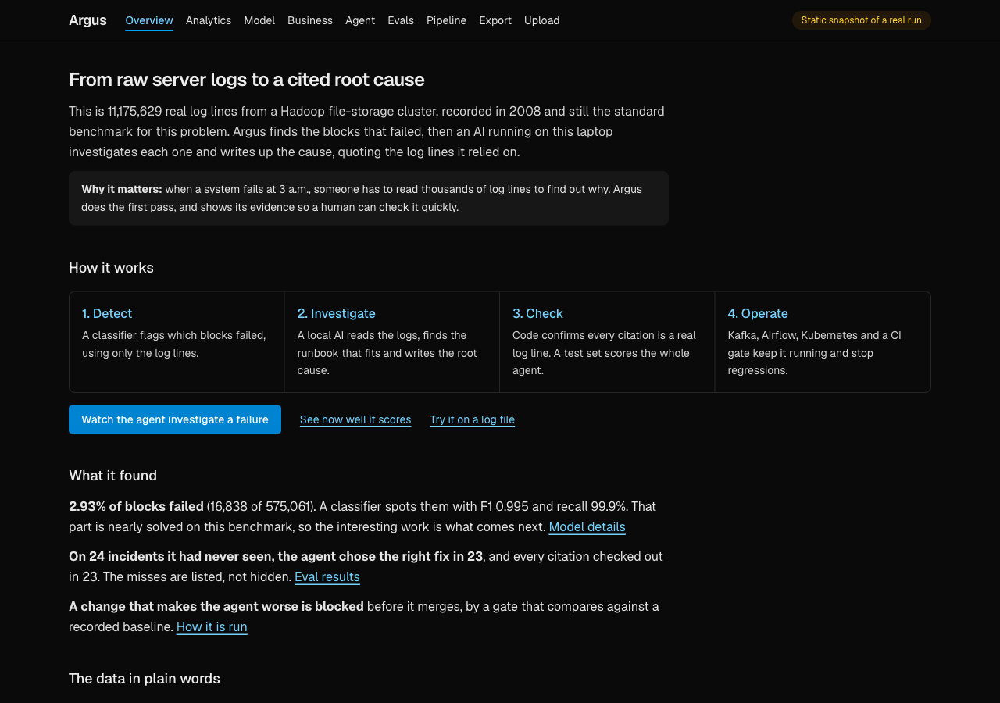
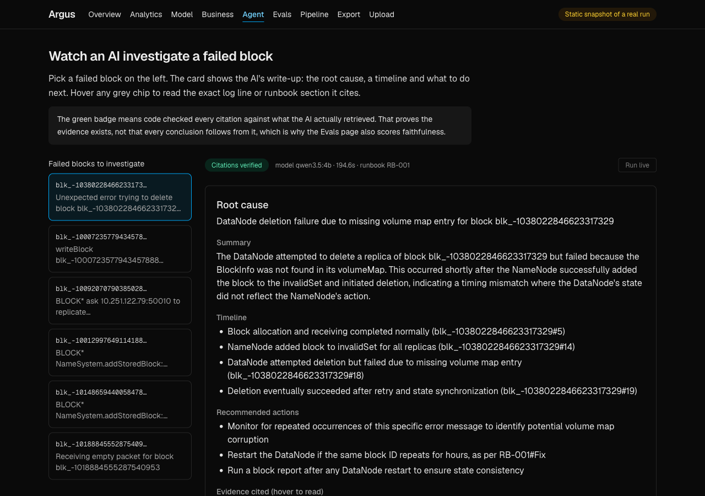
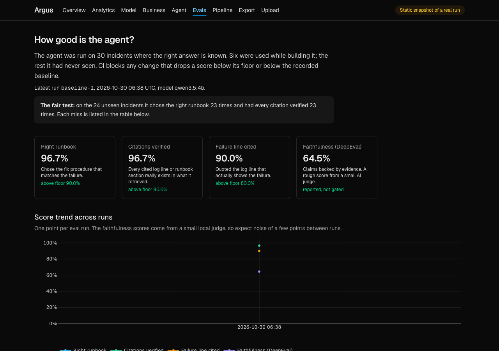

# Argus: MCP-native AIOps incident intelligence

Argus turns raw production logs into a **cited, verified incident postmortem**. A local LLM agent investigates a failed
HDFS block, but it can only reach data through three governed MCP servers, and every claim in its answer must point to
evidence those servers actually returned. Everything runs on a laptop for $0.

 



| Agent with verified citations | Evals and the CI gate |
| --- | --- |
|  |  |

**Live demo: https://anand-1502.github.io/argus-aiops/** is a static copy of the dashboard built from recorded runs and rebuilt
on every push (`.github/workflows/pages.yml`). The agent, uploads and exports need the real stack, so they are read-only there.
A five-minute demo script is in [docs/DEMO.md](docs/DEMO.md).

## What it does

1. **Ingest and analyze.** PySpark parses 11.17M real HDFS log lines into structured events in Postgres. A Next.js
   dashboard shows volume, the 2.93% anomaly rate, a breakdown by component, a live replay feed and template clusters.
   The same data is served over REST and GraphQL.
2. **Predict.** An XGBoost classifier flags failed blocks. Runs are tracked in MLflow, a promotion gate stops a worse
   model from becoming `production`, and a drift check watches for data and performance shifts.
3. **Investigate.** A LangGraph agent on a local model (Ollama) pulls the block's logs, finds its rarest events,
   searches runbooks, checks service metrics, and drafts a postmortem.
4. **Verify.** Code checks that every cited id exists in the evidence, that the chosen runbook was actually retrieved,
   and that the key quote appears word for word in the cited log line.
5. **Bring your own logs.** Upload any plain-text log (syslog, ISO-8601 app logs, epoch or HDFS timestamps). Drain3 mines
   templates, the file lands in its own Postgres schema, and the page shows volume spikes, rare templates and search.
6. **Evaluate.** A golden set of 30 incidents scores the agent. DeepEval and RAGAS judge groundedness, every run is
   traced to Arize Phoenix, and a CI gate blocks regressions.

## Results (measured, not aspirational)

| Area | Result |
| --- | --- |
| Data | 11,175,629 events, 575,061 blocks, 16,838 anomalous (2.93%), matching the published Loghub counts |
| Classifier | F1 0.995, precision 0.991, recall 0.999 on a held-out 20% of blocks (5-fold CV F1 0.997) |
| Published baselines | LogRobust 0.980 and CNN 0.982 (supervised), same style of split (Le & Zhang, ICSE 2022, Table 4) |
| Agent, 30 golden incidents | 96.7% right runbook and 96.7% verified citations (6 of 6 seeded, 23 of 24 held-out); failure line cited in 90%. Mean 79 s per incident on an 8 GB laptop |
| Agent groundedness | DeepEval faithfulness 0.64 on 8 sampled incidents (range 0.17 to 0.86, a noisy 4B judge). RAGAS did not run |
| Retrieval gate, 30 golden incidents | top-1 100%, top-3 100% (see caveats) |

HDFS is close to a saturated benchmark, so the classifier score is the least interesting number here. The agent, the
verification and the evals are the substance.

## Architecture

```
raw logs -> PySpark parser -> Postgres -> FastAPI (REST + GraphQL) -> Next.js dashboard
                                 |
                                 +-> XGBoost + MLflow (registry, promotion gate, drift)
                                 |
   LangGraph agent (Ollama) --MCP--> logs-db   (read-only, row-capped, audited tools over Postgres)
                              |----> kb        (runbooks in Qdrant, MiniLM + bge-reranker)
                              '----> metrics   (per-minute service metrics)
                                 |
   verifier -> eval runner (DeepEval, RAGAS) -> Phoenix traces -> CI gate (GitHub Actions)
```

The agent code never imports a database or vector-store client. A test enforces that, and the MCP servers expose a fixed
allow-list of tools, cap result sizes, validate input and write an audit log line for every call.

## Run it

Requires Docker, Java 17, Python 3.12 (`uv`), Node 24 and [Ollama](https://ollama.com).

```bash
docker compose up -d                      # Postgres (host port 5433), Redis, Qdrant
docker compose --profile obs up -d        # adds Arize Phoenix on :6006
uv sync --python 3.12
uv run python scripts/download_hdfs.py    # 1.5 GB, Loghub HDFS_v1
JAVA_HOME=/opt/homebrew/opt/openjdk@17 uv run python -m ingest.load      # about 15-20 minutes
uv run python -m ml.train --promote       # train, track, gate
uv run python -m scripts.build_metrics && uv run python -m kb.index && uv run python -m scripts.seed_incidents
OLLAMA_MAX_LOADED_MODELS=1 ollama serve & ollama pull qwen3.5:4b && ollama pull qwen3:4b
uv run uvicorn api.main:app --port 8000 &
cd web && npm install && npm run dev      # http://localhost:3000
```

Live feed: `uv run python -m ingest.replay --reset`. Sample logs for the Upload page: `uv run python scripts/make_sample_logs.py` (synthetic, in `tests/fixtures/`). Agent on one block: `uv run python -m agent.graph --block <id>`.

## Tests and the CI gate

```bash
scripts/test.sh            # unit and integration tests, retrieval tests, frontend checks
scripts/test.sh --agent    # also the slow end-to-end agent tests (needs Ollama)
scripts/ci_gate.sh         # the regression gate, same commands as GitHub Actions
```

The gate has three layers that CI can run without an LLM: a classifier F1 floor on a committed 20k-block sample, the
retrieval chain over 30 golden incidents loaded into an empty database, and a check of the stored agent eval. That last
check fails if the agent, retrieval, MCP-server or runbook code changed since the last eval run, because CI cannot run
the local model. The author re-runs `python -m eval.run_eval` and commits the result with the change.

## Which role does each part show?

| Role | What to look at | Real files |
| --- | --- | --- |
| **Data analyst** | A SQL layer in dbt with a star schema, window functions (running totals, moving average, lag, z-score, ntile, ranking), gaps-and-islands, an Analytics page with "show the SQL", and Tableau and Power BI exports with suggested visuals | `dbt/argus/`, `web/app/analytics`, `bi/` |
| **Business analyst** | A KPI dictionary, business requirements with user stories traced to tests, and a Business impact page whose savings come from assumptions you control, with a break-even point | `docs/KPI_DICTIONARY.md`, `docs/BUSINESS_REQUIREMENTS.md`, `web/app/business` |
| **Analytics / data engineer** | PySpark parsing of 11M lines, an idempotent loader, 44 dbt tests including reconciliation against the source, measured SQL tuning. A Kafka producer/consumer is verified end to end (50,000 real log lines through a broker into Postgres, nothing lost). The Airflow retrain DAG is verified end to end (trigger, poll, retrain, promotion gate, drift check); the nightly eval DAG imports cleanly but has not been run | `ingest/`, `airflow/`, `dbt/argus/tests/`, `docs/SQL_PERFORMANCE.md` |
| **Data scientist** | Bootstrap confidence intervals, calibration, exact SHAP, a paired significance test against baselines, error analysis, drift analysis that found a real data shift | `ml/analysis.py`, `ml/drift.py`, Model page |
| **Machine learning engineer** | MLflow registry with a promotion gate, a serving endpoint with a train/serve parity test and measured latency (p50 14 ms, p99 19 ms), drift alerts, CI gates. An Airflow DAG retrains nightly and was run end to end (about 85 s, promoted through the gate) | `ml/promote.py`, `api/serving.py`, `tests/test_serving.py`, `eval/gate.py` |
| **AI engineer** | A LangGraph agent with retrieval and reranking over governed MCP tools, citation verification, a golden set, DeepEval and RAGAS, Phoenix tracing | `agent/`, `mcp_servers/`, `kb/`, `eval/` |
| **Forward-deployed engineer** | One Helm release per client with its own taxonomy, tool allow-list, row cap and runbooks, Terraform for a local cluster, and an onboarding playbook | `deploy/`, `docs/CUSTOMER_ONBOARDING.md` |

## Honest limitations

- **The logs are from 2008.** HDFS_v1 is still the standard benchmark, which is why scores can be compared with papers,
  but it does not reflect modern systems.
- **The runbooks are authored, not official.** I wrote them from general Hadoop knowledge, so a perfect retrieval score
  mostly shows the plumbing works. They should be reviewed by someone who runs Hadoop.
- **Citation checks prove evidence exists, not that every claim follows from it.** The groundedness judges try to cover
  that gap, but a 4B local judge is noisy, and RAGAS often cannot follow its prompts on a model that small (it is recorded
  as best-effort, with failures counted).
- **Only the first six incidents were used to tune the agent.** The other 24 golden incidents were never seen during
  development, and are reported separately.
- **The metrics service is simulated.** Error-style metrics are derived from real log counts, and CPU, disk and RPC
  latency are simulated with a fixed seed. Each row says which.
- **The alert-reduction number is sensitive to one parameter.** Incident windows range from 9,830 (1 second gap) to 18 (5 minute gap).
  The dashboard uses 30 seconds and shows the whole curve. It measures clustering in labelled benchmark data, not a drop in real pages.
- **Business impact is a model.** The minutes and hourly cost are assumptions the reader sets. Nothing here measures real savings.
- **Uploads are unlabelled and capped.** 50 MB or 500,000 lines, one schema per upload, no authentication. Insights come from
  rarity and volume spikes, not from the HDFS-trained classifier, which does not transfer to other systems. The two sample
  files for it are synthetic, not real production logs.
- **The three demo clients share seed data.** Each Helm release gets its own namespace, Postgres, taxonomy, tool allow-list
  and runbooks, but all three load the same 641-event fixture, so the difference is configuration, not data.
- **Runs on a laptop.** A live investigation takes one to three minutes on an 8 GB Mac.

## Roadmap

Built and verified: ingest, API, dashboard, ML, the agent, evals with a CI gate and Phoenix tracing, the Tableau and Power BI
export, the dbt SQL layer, the upload flow, a Pipeline status page and a static demo site. Kafka, the Airflow retrain DAG and
the Kind cluster with three client releases were each run end to end.

Still to do: a recorded demo video, an expert review of the runbooks, and running the nightly eval DAG under Airflow.

## Layout

```
ingest/       Spark parser, loader, replay, FAISS template clustering, upload parser (Drain3)
api/          FastAPI app, GraphQL schema, shared queries
ml/           features, training, promotion gate, drift
kb/           runbooks, embedding, Qdrant index, reranked search
mcp_servers/  logs-db, kb, metrics, shared access control and audit log
agent/        LangGraph agent, MCP client, citation verifier, tracing
eval/         golden set, eval runner, judges, CI gate, thresholds
scripts/      data download, seeding, tests, CI gate, nightly jobs, snapshot + static build
docs/         KPI dictionary, requirements, onboarding, SQL tuning, demo script, screenshots
web/          Next.js dashboard (Overview, Analytics, Model, Business, Agent, Evals, Pipeline, Export, Upload)
```
